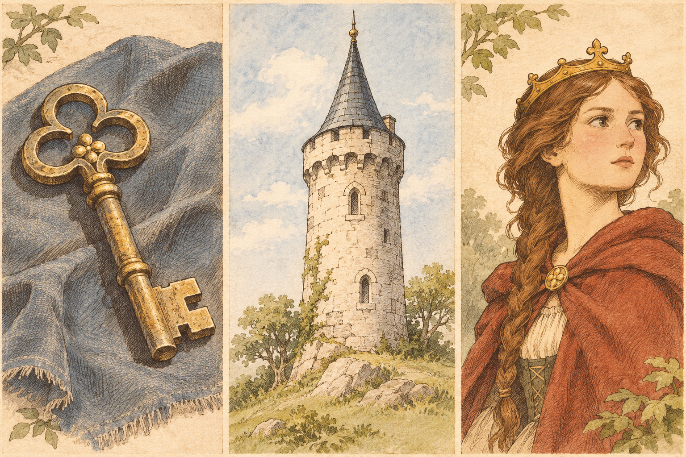

# 西方童话 · 插画画风参照 v1

从左至右是牌库里的 A13「钥匙」、A29「高塔」和 A33「公主」。这张三联图用来对照金属、石材与人物的画法。制作单牌时，把参照图和下方提示词一同提供给绘图工具，只替换方括号里的内容。

## 单牌基础提示词

> 为西方童话桌游绘制一幅原创竖幅插画。牌名为【牌名】。用【一个主体或一个清楚的动作】表现这张牌；一眼辨认它的线索是【外形、姿态或物件关系】。背景只交代【一处环境线索】。  
> 沿用所附参照图的深棕钢笔线与透明水彩。主轮廓稍重，内线较细；短排线顺着体积转折，亮处透出暖象牙色纸底。用灰蓝、苔绿、赭石和旧金组织画面，砖红仅作局部点色。左上方柔光拉开主体与背景的明暗。整体像一本装帧朴素的欧洲童话集里的手工设色插页。  
> 输出一张约 4:5 的竖幅矩形单图。先把画面想象成一个内接竖椭圆，将主体的视觉重心放在画布中心附近。主要物件或人物约占画高的三分之二，关键轮廓与椭圆边缘留出呼吸空间。背景在四边自然延伸，脸、手势及辨识物完整落在中央竖椭圆内，四角只放可裁切的背景；缩到手机三列手牌大小仍能认出主题。只画插画，省去牌名、文字、边框、椭圆描边、签名和水印。

## 三种题材怎样填写

| 牌名 | 主体或动作 | 辨识线索 | 环境线索 |
| --- | --- | --- | --- |
| A13 钥匙 | 一把斜放的旧黄铜钥匙 | 三叶形匙柄、细长匙身和完整方齿 | 一折灰蓝亚麻布 |
| A29 高塔 | 一座高出树冠的孤塔 | 狭长石砌塔身、锥形塔顶、底部一扇小门 | 浅天空和贴近地面的低矮树丛 |
| A08 获救 | 岸上的人俯身，把落水者拉上石阶 | 两只手在画心扣住，落水者一膝已搭上台阶 | 台阶旁露出一线水面 |

同一张固定参照图可贯穿整套牌。验图时先遮住牌名，看小图能否认出「钥匙」或「获救」；再叠上实际卡框，看椭圆边缘有没有截掉匙齿、手势或人物脸部。事件牌尤其要保留决定动作含义的那一瞬间。
